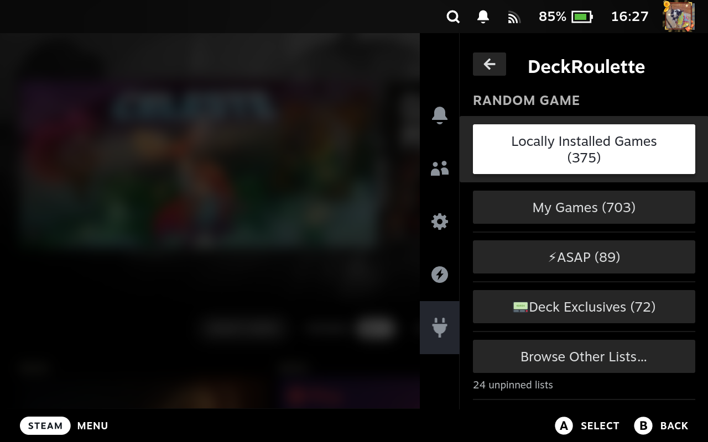

# DeckRoulette (with Sort)

A fork of [chrisae9/deck-roulette](https://github.com/chrisae9/deck-roulette)
that adds sorting to the list screens. It is kept in sync with the parent
(currently based on v1.3.27).

Decky Loader plugin for opening a random game from your library or Steam
collections.



## Features

- Choose from Locally Installed Games, My Games, or any Steam collection.
- Pin, unpin, and reorder game lists in Quick Access.
- Browse unpinned collections and return to the last selected list.
- Exclude collections from Locally Installed Games and My Games while keeping
  them available as individual roulette lists.

## Sorting (added in this fork)

A **🔀 Sort** button appears in two places. It shows the order you will switch
**to**, and the line under it shows the order that is **currently** in use.
Each press cycles to the next of three orders:

| Mode | Order |
| --- | --- |
| **Alphabetical** (default) | A–Z, the same as the parent plugin |
| **Recently Rouletted** | Lists you most recently used the roulette button on come first |
| **Recently Opened** | Lists you most recently picked with the roulette button, opened in your Library, or played a game from, come first |

- **Quick Access → Browse Other Lists…** sorts the unpinned lists.
- **Customize Shortcuts → Available Shortcuts** sorts the lists you can pin.

Notes:

- *Locally Installed Games* and *My Games* always stay at the top.
- Lists that tie (for example, never rouletted) fall back to A–Z.
- Your pinned shortcuts keep the manual order you set.
- Library visits are recorded while the plugin is loaded, starting from the
  version that introduced them (1.3.27-sort.2, widened in 1.3.27-sort.3).
- **Recently Opened Diagnostics** (bottom of Customize Shortcuts → Shortcuts) lists
  the last pages Steam reported and how many collection visits were recorded.
  It is a temporary aid while collection-visit tracking is being confirmed.
- The chosen sort and the roulette history are remembered between sessions.
  They are stored on the Deck in the Steam UI's local storage, so they are not
  part of the plugin's `settings.json`.

## Installing

Download `DeckRoulette-with-sort-<version>.zip` from the
[Releases](https://github.com/SilvertongueRED/deck-roulette-with-sort/releases)
page, copy it to your Steam Deck, then in Decky: **Settings → General → turn on
Developer Mode → Developer → Install Plugin from ZIP**. Remove any other
DeckRoulette install first, because they share the same plugin name.

## Releases

Release notes live in [`release-notes/`](release-notes). When a push to `main`
changes the version in `package.json`, the **Release** GitHub Action builds the
plugin and publishes a release using `release-notes/<version>.md`.

## Development

```sh
npx -y pnpm@9.4.0 install --frozen-lockfile
npx -y pnpm@9.4.0 test
npx -y pnpm@9.4.0 build
```
